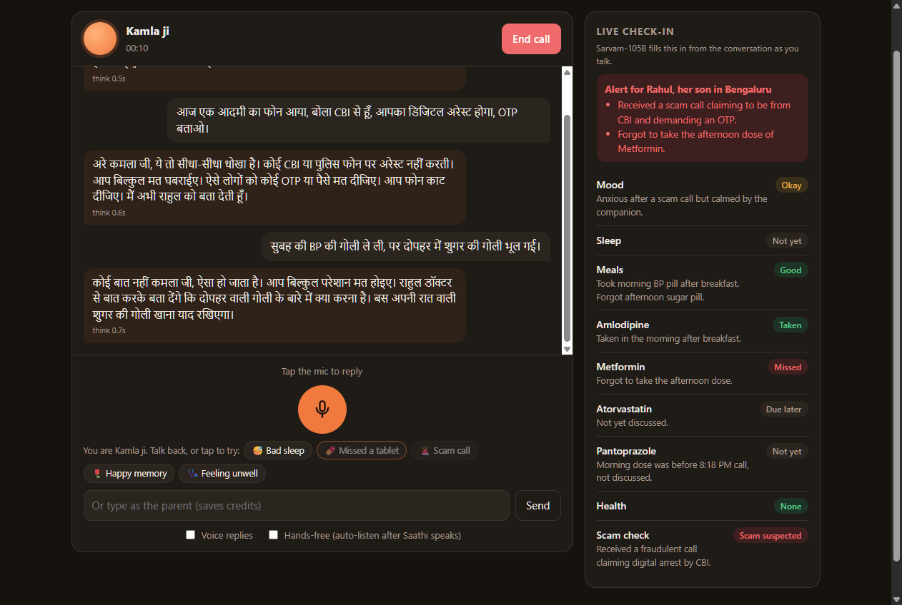
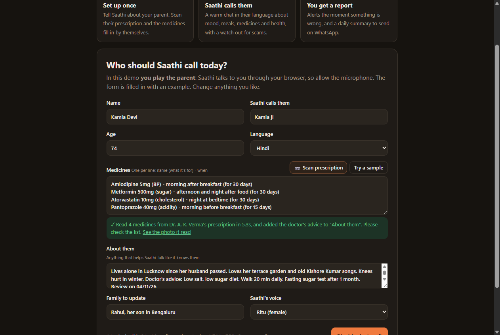
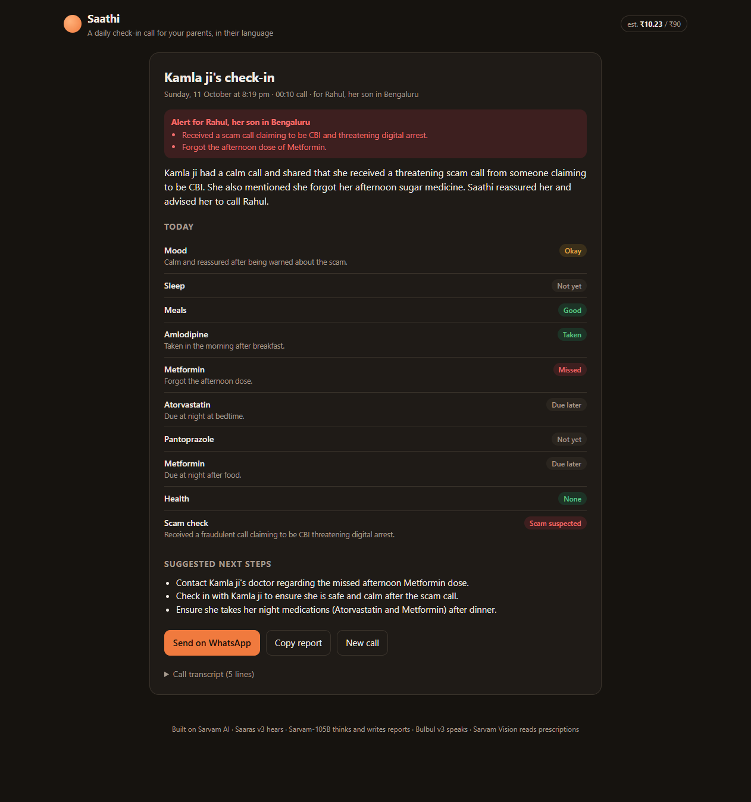
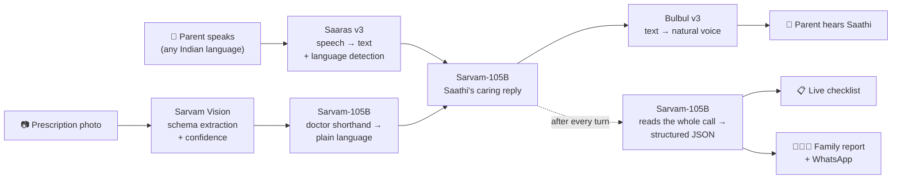

# Saathi: a daily check-in call for your parents, in their language

**Saathi is an AI voice companion that calls elderly parents every day, chats with them warmly in their own language, keeps them safe from scams and missed medicines, and sends the family a short report.**

Built entirely on **Sarvam AI**, using 4 Sarvam models: Saaras v3, Sarvam-105B, Bulbul v3 and Sarvam Vision. It works in **11 Indian languages**.



---

## Why this matters

Many elderly parents in India live alone while their children work in other cities. Families worry, but can't call every day, and short calls miss the things that matter:

| The everyday risk | What usually happens |
|---|---|
| 💊 **Missed medicines** | BP and sugar tablets get forgotten, and nobody knows until something goes wrong. |
| 🩺 **Hidden health problems** | A fall, dizziness or chest pain goes unreported: "I didn't want to bother anyone." |
| 🚨 **Scams aimed at seniors** | Fake "CBI digital arrest", "KYC expiring, tell me the OTP" and "electricity will be cut tonight" calls drain savings before the family even hears about it. |
| 😔 **Loneliness** | Whole days pass without a real conversation. |
| 🗣️ **Language** | Most apps and helplines expect English. Many elders are only comfortable in Hindi, Tamil, Bengali, Marathi and other regional languages. |

This project comes from the **"Elder Companion Agent"** idea in the Sarvam idea library: daily voice check-ins in regional languages, medicine reminders, scam warnings and family summaries. We built that, then added prescription scanning, a live checklist and a "memory of the day".

---

## What Saathi does

1. **The family sets it up once.** Name, language, medicines and a few personal details. **Snap a photo of the prescription** and Sarvam Vision fills in the medicine list.
2. **Saathi calls the parent.** It greets them by name and talks like a caring grandchild would, one question at a time, in their language. It naturally covers mood, sleep, meals, each medicine, health and any suspicious calls.
3. **It protects them during the call.** It recognises scams and calmly tells them not to pay or share anything. For red flags like chest pain or a fall, it tells them to call 112 or family right away.
4. **The family gets a report.** It includes alerts, a status for every medicine, health, the scam check, suggested next steps and a "memory of the day", ready to **send on WhatsApp in one tap**.

---

## Features

### 🗣️ Natural voice conversation
- **11 Indian languages**: Hindi, English, Bengali, Marathi, Tamil, Telugu, Kannada, Malayalam, Gujarati, Punjabi and Odia. The spoken language is auto-detected, and Saathi follows if the parent switches languages mid-call.
- **Hands-free like a real call**: Saathi listens, notices when you stop talking, replies, and listens again. No buttons to hold.
- **Interrupt any time**: tap the mic while Saathi is speaking.
- **Gender-correct grammar**: a female voice says "बोल रही हूँ", a male voice says "बोल रहा हूँ" (voice genders come from Sarvam's voice catalogue).
- **Personal**: Saathi uses what the family told it (hobbies, health, family) so it sounds like it knows them.
- **Slightly slower speech**, tuned for elderly listeners.

### 🛡️ Safety
- **Scam shield** for digital arrest, fake police/CBI/customs, KYC and bank updates, OTP/PIN/UPI requests, electricity cut-offs, parcel-with-drugs threats, lottery prizes and "relative needs money urgently". Saathi says clearly but kindly that it's a fraud and flags it for the family.
- **Health red flags** for chest pain, breathlessness, falls, sudden weakness, confusion, fainting and high fever. Saathi tells them to call 112 or family now and raises an alert.
- **Never plays doctor**: it doesn't diagnose or recommend medicines, and has a **hard rule against missed-dose advice**. It never says "take it now" or "take extra"; it says the family will check with the doctor.

### 📋 For the family
- **Live check-in panel** that fills itself in during the call: mood, sleep, meals, each medicine (taken / missed / due later), health and scam check.
- **Smart medicine tracking**: it knows the time of the call, so a dinner dose at 1 PM is "due later", not "missed".
- **Family report card** with a summary, alerts, per-medicine status and suggested next steps.
- **Memory of the day**: a story or happy moment they shared, e.g. *"the first rose bloomed on the terrace today, from the plant her husband planted"*.
- **One-tap WhatsApp share** and **copy report**, plus the full transcript.

### 📷 Prescription scan (v2)
- Photo or PDF of a prescription, handwritten or printed. **Sarvam Vision** extracts every medicine, dose code, instruction and duration with confidence scores.
- **Sarvam-105B** turns doctor shorthand into plain language: `0-1-1 after food` becomes "afternoon and night after food", and it adds what each medicine is for (BP, sugar, cholesterol and so on).
- Low-confidence readings are flagged ("Not sure about: …"), and the doctor's advice (diet, tests, next visit) is added to Saathi's notes so it can remind them.
- A **"Try a sample"** button for anyone without a prescription handy.

### 🧭 Easy to understand
- A 3-step "how it works" intro, a pre-filled example parent, and a clear "you play the parent" note.
- **Tap-to-try suggestions** on the call screen (😴 bad sleep, 💊 missed tablet, 🚨 scam call, 🌹 happy memory, 🩺 feeling unwell), so a first-time visitor sees every feature in a minute.
- Works on phones and laptops, in light and dark mode.

### 💰 Built to be cheap and safe to host
- **Live credit meter** in the corner, plus a **budget cap** that stops API calls at a set amount.
- **"Type instead" and "voice off" modes** that cost almost nothing while testing.
- An **access code lock** (`ACCESS_CODE`) so a public deployment can't be used by strangers to drain credits.

---

## Screenshots

| 1. Set up (with prescription scan) | 2. The family report |
|---|---|
|  |  |

The sample prescription it reads is at [samples/prescription_demo.jpg](samples/prescription_demo.jpg). It's a made-up demo, not a real record.

---

## How it works



| Sarvam model | API | Its job in Saathi |
|---|---|---|
| **Saaras v3** | `POST /speech-to-text` | Hears the parent in any of 22 Indian languages and detects which one they're speaking |
| **Sarvam-105B** | `POST /v1/chat/completions` | Three jobs: (1) holds the conversation, (2) turns the call into a structured health and safety report, (3) rewrites prescription shorthand into plain language |
| **Bulbul v3** | `POST /text-to-speech` | Speaks Saathi's replies in a warm Indian voice (12 voices to choose from) |
| **Sarvam Vision** | `POST /doc-ai/v1/job/extract` | Reads handwritten or printed prescriptions into structured fields using a JSON schema |

### Under the hood

- **Low latency for a voice call**: Sarvam-105B runs with reasoning turned off (`reasoning_effort: null`). Replies are split into sentence groups and **voiced by Bulbul in parallel**, then played back in order, so voice time doesn't grow with reply length. Before this change a long reply took 3.6s; replies now take about 1.2–1.6s.
- **Voice activity detection in the browser**: the Web Audio API tracks the noise floor, detects speech, and auto-sends after a short pause. Silence and empty clips are never sent, so they never cost credits.
- **Right voice for the right script**: the TTS language is picked from the script of Saathi's reply (Devanagari, Tamil, Bengali and so on), with the detected spoken language as a tiebreaker (e.g. Marathi vs Hindi).
- **Two LLM roles**: one prompt holds the warm conversation, and a separate temperature-0 prompt extracts a strict JSON report. Conversation quality and report accuracy don't compete for the same prompt.
- **Sarvam Vision jobs**: the app creates an extract job with a JSON schema, polls its status, fetches the results, and uses the per-field confidence scores to flag uncertain medicines.
- **All behaviour lives in one file**: prompts, safety rules, report schema, voices and budget are in `persona.py`. Change that file to make a different agent.

### Measured during testing

| Step | Typical time |
|---|---|
| Speech-to-text (Saaras v3) | ~0.3 s |
| Saathi's reply (Sarvam-105B) | 0.4 to 0.9 s |
| Voice (Bulbul v3, parallel chunks) | 1.2 to 1.6 s |
| Prescription scan (Vision + 105B) | 5 to 6 s |

A full 8–10 reply call costs about **₹4–6** in Sarvam credits, and a prescription scan about **₹1**. New Sarvam accounts get ₹100 free.

---

## Try it in 2 minutes

1. Open the app. The form is pre-filled with **Kamla ji, 74, from Lucknow, who speaks Hindi**.
2. Click **📷 Try a sample**. Sarvam Vision reads a prescription and fills in 4 medicines.
3. Click **Start today's call** and allow the microphone. Saathi greets her in Hindi.
4. Reply out loud, or tap the suggestions:

   | Tap / say | What you'll see |
   |---|---|
   | 😴 *"रात को घुटनों में दर्द था, नींद नहीं आई"* (my knees hurt at night, I couldn't sleep) | Sleep and health update in the live panel |
   | 💊 *"शुगर की गोली भूल गई"* (I forgot my sugar tablet) | Medicine marked **Missed**, and Saathi reassures without giving dose advice |
   | 🚨 *"CBI से फोन आया, डिजिटल अरेस्ट होगा, OTP बताओ"* (CBI called, digital arrest, tell them the OTP) | Saathi says it's a fraud, and a **red alert** appears for the family |
   | 🌹 *"छत पर गुलाब में पहला फूल आया"* (the first rose bloomed on the terrace) | Becomes the **memory of the day** |
   | 🩺 *"सीने में दर्द हो रहा है"* (I have chest pain) | Saathi tells her to call 112 or family, and a red-flag alert appears |

5. Click **End call** to see the family report, then **Send on WhatsApp**.

---

## Run it yourself

You need Python 3.10+ and a Sarvam API key from [dashboard.sarvam.ai](https://dashboard.sarvam.ai).

```bash
git clone https://github.com/23ME30056/saathi-voice-agent-SARVAM.git
cd saathi-voice-agent-SARVAM
pip install -r requirements.txt
```

Create a `.env` file:

```
SARVAM_API_KEY=your_key_here
```

Start it, then open **http://127.0.0.1:8000** in Chrome or Edge:

```bash
python app.py
```

### Deploy

The repo includes a `Dockerfile`. On any Docker host (Render, Railway, Fly.io, a VPS):

1. Create a web service from this GitHub repo using the Dockerfile.
2. Set the environment variables:
   - `SARVAM_API_KEY`: your key
   - `ACCESS_CODE`: any password, so only people you share it with can use your credits
3. The app reads the host's `PORT` automatically. The microphone needs HTTPS, which these hosts provide.

---

## Project structure

| File | What's inside |
|---|---|
| `persona.py` | Saathi's personality, conversation and safety rules, report schema, prescription schema, voices, budget settings |
| `app.py` | FastAPI server: call start, conversation turns, live insights and report, prescription scan, access-code lock |
| `sarvam.py` | Sarvam API client (STT, chat, TTS, Vision jobs), credit meter, language and script detection |
| `static/index.html` | The whole web app in one file: setup, prescription scan, call screen with voice detection, live panel, report |
| `samples/` | Demo prescription photo |
| `docs/` | Screenshots |
| `Dockerfile` | For deployment |

## Tech stack

| Layer | Tech |
|---|---|
| AI | **Sarvam AI**: Saaras v3 (STT), Sarvam-105B (LLM), Bulbul v3 (TTS), Sarvam Vision (document AI) |
| Backend | Python, FastAPI, httpx (async), Uvicorn |
| Frontend | Plain HTML, CSS and JavaScript (no build step), MediaRecorder API, Web Audio API (voice detection), Canvas (photo resizing) |
| Sharing | WhatsApp share links |
| Deploy | Docker |

---

## Safety and limits

- Saathi is a **companion, not a medical service**. It never diagnoses, never recommends medicines, and never advises on missed doses.
- Prescription readings should be **checked by the family** before use. The app says so and flags low-confidence fields.
- In this demo the call happens in the browser and the report is shared through a WhatsApp link. Real phone calls and automatic alerts are on the roadmap.
- Conversations are kept in memory only, and nothing is stored once the server restarts.

## Roadmap

- 📞 **Real phone calls** at a fixed time every day, so it works on any phone, including feature phones
- 🔔 **Automatic WhatsApp or SMS alerts** to the family the moment a scam or red flag is detected
- 📈 **Weekly trends** for mood, sleep and medicine adherence over time
- 🗓️ **Appointment and test reminders** from the doctor's advice
- 👨‍👩‍👧 **Family dashboard** for multiple parents and multiple family members

## Versions

- **v2**: prescription scan with Sarvam Vision and Sarvam-105B, tap-to-try suggestions, how-it-works intro, stronger missed-dose safety rule, smarter "due later" medicine logic, access-code lock, Dockerfile.
- **v1**: voice calls in 11 languages, scam shield, health red flags, live checklist, family report with WhatsApp share, memory of the day, parallel TTS, gender-correct grammar, credit meter.
